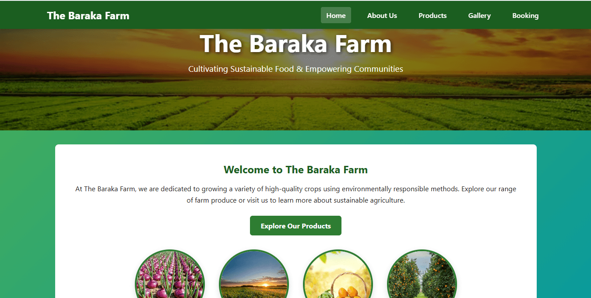
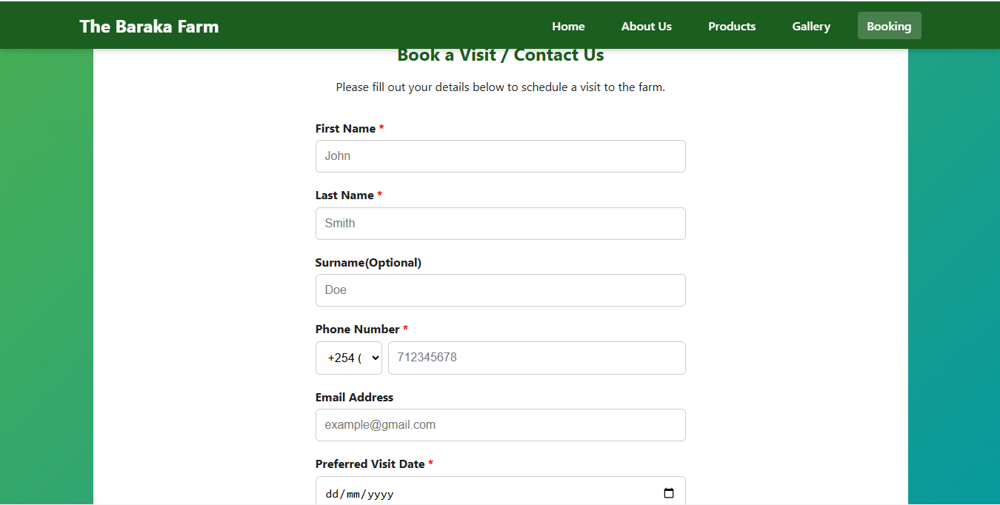
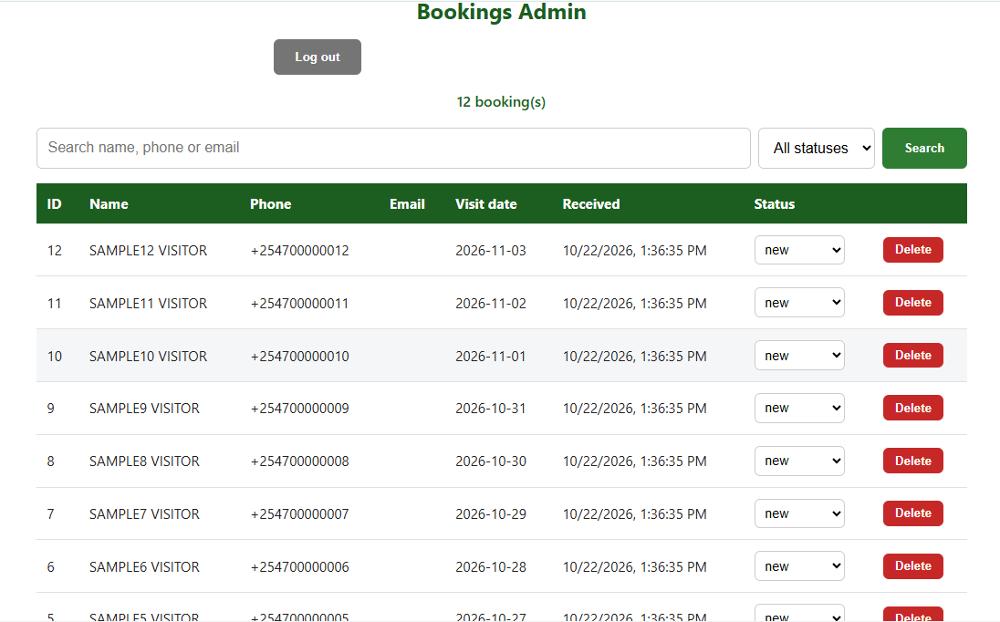
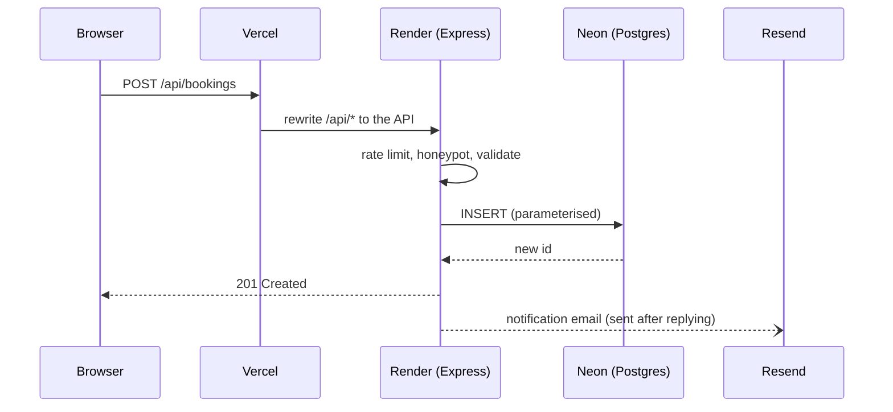

# The Baraka Farm


A full-stack booking site for a farm: visitors request a visit, the owner gets an email, and a protected admin page manages the requests. Built to learn backend development with one language end to end (JavaScript, Node.js, Express, PostgreSQL), then deployed on free tiers.

**Live site:** https://barakafarm.vercel.app

> The first booking request after a quiet spell can take up to a minute, because the free API host sleeps when idle. The booking page wakes it in the background.





## What this project demonstrates

- A JSON API in Express 5 with middleware, server-side validation and central error handling
- PostgreSQL with parameterised queries, a connection pool, and SQL migrations
- Authentication built from scratch: scrypt password hashing, hashed session tokens, hardened cookies
- Defence in depth: rate limiting, security headers, a honeypot field
- Unit and API tests, run automatically on every push with GitHub Actions
- Separate development, test and production databases using Neon branches
- Deployment across Vercel, Render and Neon, with the trade-offs written down

## Features

- **Responsive Hero Section:** Eye-catching hero banner featuring background media and dark overlays for optimal readability.
- **Product Catalog:** Showcases high-quality crops grown using environmentally responsible farming methods.
- **Modern UI Design:** Clean navigation with CSS variable-driven styling, smooth hover transitions, and sticky navigation headers.
- **Mobile-Friendly Layout:** Built with fluid CSS Flexbox and Grid, ensuring seamless usability across mobile, tablet, and desktop viewports.
- **Visit Booking:** A booking form that validates input on the server, saves requests to a database, and emails the owner.
- **Admin Page:** Password-protected page to search, filter, page through, update and delete booking requests, and to change the admin password.
- **Security Basics:** Hashed passwords, session cookies, rate limiting, security headers, and a honeypot field against simple bots.

---

## Built With

- **HTML5:** Semantic markup structure.
- **CSS3:** Custom properties (CSS variables), Flexbox layout, and CSS transitions.
- **JavaScript:** Interactive DOM manipulation in the browser, and the whole backend in Node.js.
- **Node.js 22 + Express 5:** The API, login and validation.
- **PostgreSQL on Neon:** Database for bookings, admin users and sessions.
- **Resend:** Email notifications over HTTPS.
- **Vercel and Render:** Hosting for the static site and the API.

---

## How It Fits Together

| Part | Where it runs | Job |
|---|---|---|
| Static pages (`public/`) | Vercel | The website: pages, styles, scripts, admin page |
| API (`server/`, Express) | Render (free) | Validation, login, bookings, email |
| Database | Neon (Postgres) | Stores bookings, admin users, sessions |
| Email | Resend | Notifies the owner of new bookings |

Vercel forwards every `/api/*` request to Render through a rewrite in `vercel.json`, so the browser only ever talks to one address.

## Architecture



## Project Structure

```
public/            static site (HTML, CSS, JS, images, admin page)
server/
  app.js           the Express app (routes, middleware)
  server.js        starts the app (imports app.js)
  db.js            Postgres pool and table setup
  auth.js          password hashing, sessions, requireAdmin
  validate.js      input validation
  email.js         booking notification email
  create-admin.js  creates or updates an admin account
tests/             unit and API tests (Node's built-in test runner)
vercel.json        Vercel config and the /api rewrite
```

---

## Getting Started

### Just browsing the pages

Open `public/index.html` in any modern browser (Chrome, Firefox, Edge, Safari). The booking form and admin page need the backend, so they won't work this way.

### Running everything locally

**Prerequisites:** Node 22 or newer, and a free [Neon](https://neon.com) account.

1. `npm install`
2. Copy `.env.example` to `.env` and fill it in. Use your **development** Neon branch, never production.
3. Create an admin account: `node --env-file=.env server/create-admin.js yourname "a-long-password"`
4. `npm run dev`, then open http://localhost:3000

### Environment variables

| Name | Where | Purpose |
|---|---|---|
| `DATABASE_URL` | local `.env`, Render | Neon connection string (development branch locally, production on Render) |
| `NODE_ENV` | Render (`production`) | Turns on secure cookies, stops serving static files, enables the redirect |
| `NODE_VERSION` | Render (`22`) | Node version Render uses |
| `FRONTEND_URL` | Render | Vercel address that stray visitors are redirected to |
| `RESEND_API_KEY`, `NOTIFY_EMAIL` | local, Render | Booking notification emails (skipped if empty) |
| `PORT` | set by Render | Port the server listens on |

### Scripts

- `npm run dev` runs the server with auto-restart and loads `.env`
- `npm start` runs the server (used by Render)
- `npm test` runs all tests against a separate Neon `test` branch

### Tests

`npm test` loads `.env.test`, which must contain `NODE_ENV=test` and the connection string of the **test** branch. The test helpers wipe tables and refuse to run otherwise. Never point `.env.test` at development or production.

---

## Deploying

- **Render:** Web Service, Node, region matching the Neon database, build `npm install`, start `npm start`, free instance. Set the environment variables above.
- **Vercel:** "Other" framework preset, no build command. `vercel.json` sets the output directory to `public` and rewrites `/api/*` to the Render address (the URL there is written directly, not an environment variable).
- **Neon:** branches `production` (live), `development` (local work), `test` (automated tests). Turn off automatic expiry on all of them.

---

## Decisions and trade-offs

| Decision | Why | Trade-off |
|---|---|---|
| The server validates everything again | The browser can be bypassed (console, Postman, bots) | Rules live in two places |
| Parameterised SQL only | Visitor text is sent as data and can never become SQL | Dynamic filters need care: fixed fragments plus a parameter list |
| Sessions with hashed tokens in Postgres | A stolen database can't be used to log in, and sessions can be revoked | One database lookup per admin request |
| Email is sent after replying, errors caught | A broken email service must never fail a booking | A failed notification is only logged |
| Resend over HTTPS instead of SMTP | Render's free tier blocks SMTP ports | Until a domain is verified, the free sender can only email the account owner |
| Static site on Vercel, API on Render | Visitors see pages instantly while the free API wakes up | Two hosts and a rewrite to maintain, and the first API call after idle can take up to a minute |
| Migrations instead of editing `CREATE TABLE` | Every environment gets the same changes, once, in order | Changes must stay backward compatible while a deploy rolls out |
| Neon branches for development, test and production | Tests wipe data and must never touch real bookings | Branches need automatic expiry switched off |
| IP rate limiting plus per-username and global limits | A caller can forge `X-Forwarded-For`, because the API is reachable by two paths | The limits are a speed bump, not a wall |

## Known limitations and next steps

- One admin account and no password-reset email
- The API is also reachable directly on its Render address. Restricting it to Vercel would close the IP-spoofing gap.
- Confirmation emails to visitors need a verified sending domain
- The admin page is plain JavaScript, so a React version would be a good next project
- Resetting the production admin password: put the production connection string in `.env.production` (never commit it) and run `node --env-file=.env.production server/create-admin.js yourname "new-password"`